<a href="https://playchained.me">
  <picture>
    <source media="(prefers-color-scheme: dark)" srcset="assets/name-tiles-dark.svg">
    
  </picture>
</a>

Software engineer · B.A. Computer Science, UNC-Chapel Hill ’26 · minor in Data Science

I build backend-heavy web apps in Python and TypeScript, and I like owning them end to end, from the data model to the server they run on.

## Featured work

<table>
<tr>
<td width="50%" valign="top">

<a href="https://playchained.me">
  <picture>
    <source media="(prefers-color-scheme: dark)" srcset="assets/chained-card-dark.svg">
    
  </picture>
</a>

### [Chained ↗](https://playchained.me)

A daily word-chain puzzle. Each word joins the next to make a compound word, and you start with only first letters.

- FastAPI + PostgreSQL API; answers stay server-side until solved
- Argon2 + JWT in httpOnly cookies, guest-to-account progress merge
- React + TypeScript front end with streaks and spoiler-free sharing
- AWS EC2, nginx, systemd, HTTPS, nightly backups, 40+ pytest tests

Sep – Oct 2026 · [source code](https://github.com/AhmedM240/chained)

</td>
<td width="50%" valign="top">

<picture>
  <source media="(prefers-color-scheme: dark)" srcset="assets/mlt-card-dark.svg">
  
</picture>

### MLT

A memory diagram learning tool that checks how students draw Python's stack, heap, and output.

- Visualizes stack, heap, and output states as code runs
- Deterministic tracing engine for automated grading
- AI feedback pipeline on RabbitMQ flags conceptual errors
- FastAPI + PostgreSQL, deployed on Kubernetes

Apr – May 2026 · team project

</td>
</tr>
</table>

<!-- chained-today:start -->
**Today's [Chained](https://playchained.me) · #41** &nbsp; `W` → `C` → `B` → `G` → `P` &nbsp; 5 words, first letters only · [solve it](https://playchained.me)
<!-- chained-today:end -->

## Toolbox

<b>LANGUAGES</b> 

<b>BACKEND</b> 

<b>FRONTEND</b> 

<b>INFRASTRUCTURE</b> 

## Experience

All at UNC-Chapel Hill.

| Role | What I did | When |
|:--|:--|:--|
| AI-Enabled Technical Writer | Wrote assignments, lectures, and reference guides for a 300-student Data Structures course | Jun – Jul 2026 |
| Lead Undergraduate TA | Designed and graded assignments for upper-level CS courses with 150+ students; ran 8–10 hours of office hours a week | Aug 2025 – May 2026 |
| Undergraduate Researcher | Studied how well Go-Valuate predicts student performance and learning outcomes | Dec 2025 – May 2026 |
